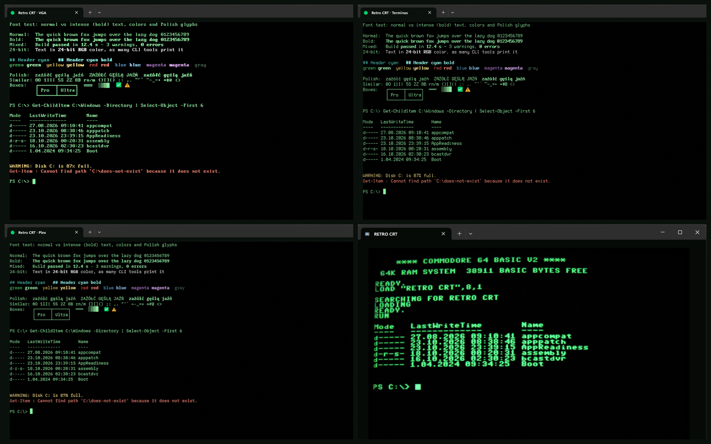
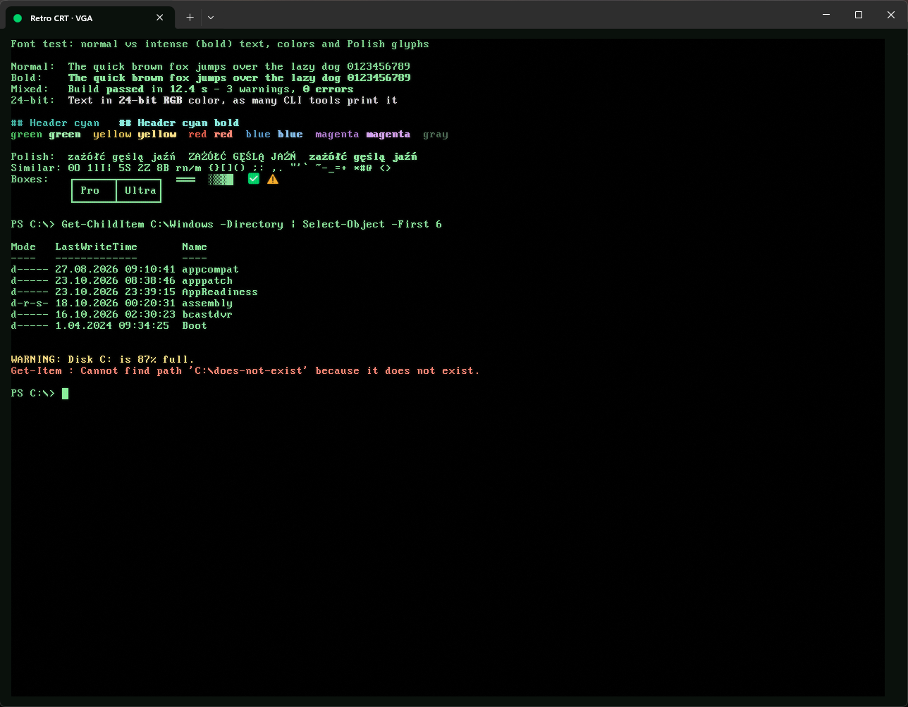
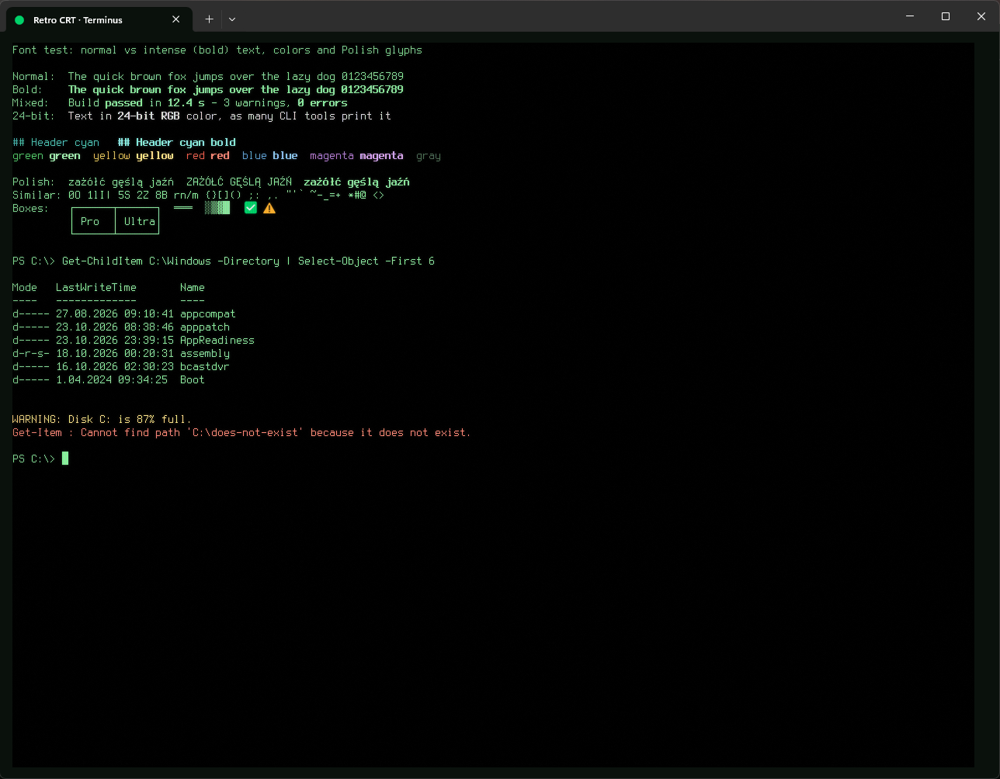
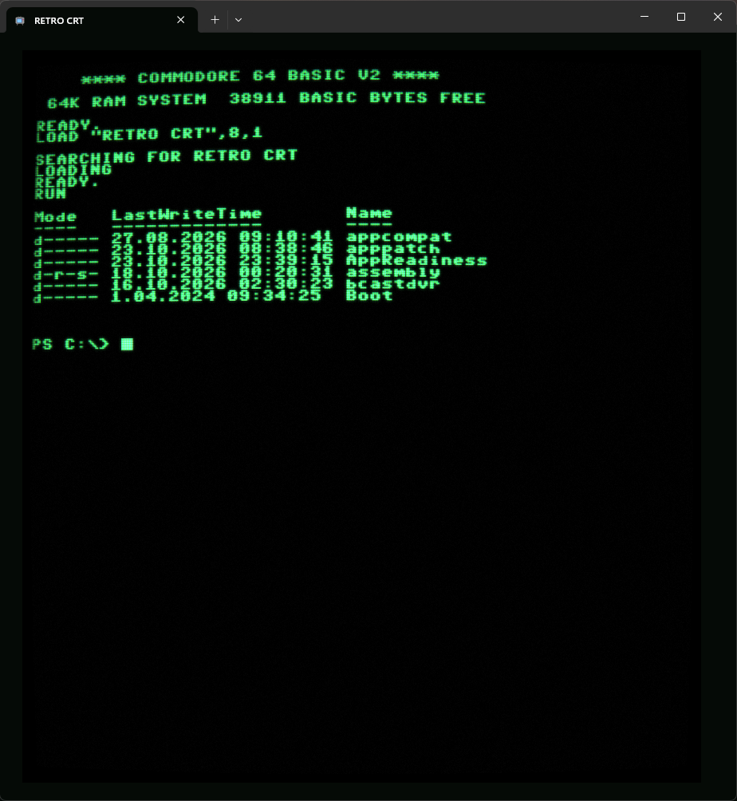

# windows-terminal-retro-crt

**English** | [Polski](README.pl.md) · [Website](https://raptyk.github.io/windows-terminal-retro-crt/)

Retro CRT look for Windows Terminal: four profiles with phosphor color schemes, CRT pixel shaders and classic terminal fonts. One script installs everything on a clean Windows.



> [!IMPORTANT]
> **Platform: Windows only**  
> Windows 10 / 11. Windows Terminal and PowerShell 7 are installed automatically when missing. Everything installs for the current user; no administrator rights are needed, except when winget installs PowerShell 7.

## Profiles

| Profile | Font | Shell | Look |
|---|---|---|---|
| **Retro CRT · VGA** | PxPlus IBM VGA 9x16, 12 pt | Windows PowerShell | Everyday use. Original IBM VGA text mode font, pixel-perfect. |
| **Retro CRT · Terminus** | Terminus (TTF), 12 pt | Windows PowerShell | Everyday use. Linux console font with a real bold. |
| **Retro CRT · Plex** | IBM Plex Mono, 10 pt | Windows PowerShell | Everyday use. Smooth vector font, the least "pixel". |
| **Retro CRT · C64** | C64 Pro Mono, 11 pt | PowerShell 7 | For fun: curved glass, strong glow, scanlines, flicker and noise. |

The three everyday profiles share the `crt-daily.hlsl` shader (scanlines, glow around glyphs, darker tube edges, no animation) and the **Retro CRT · Phosphor Daily** color scheme: phosphor green text, while errors, warnings and git output keep their hues. The C64 profile uses `crt.hlsl` and **Retro CRT · Green Phosphor**.

| VGA | Terminus |
|---|---|
|  |  |
| **Plex** | **C64** |
|  |  |

## Install

```powershell
git clone https://github.com/raptyk/windows-terminal-retro-crt
cd windows-terminal-retro-crt
powershell -ExecutionPolicy Bypass -File .\install.ps1
```

No git? Download the [ZIP](https://github.com/raptyk/windows-terminal-retro-crt/archive/refs/heads/main.zip), unpack it and run `install.ps1` the same way.

Then close **all** Windows Terminal windows and start it again (Terminal loads the font list only at startup). The profiles are in the new tab menu.

What `install.ps1` does:

1. Installs Windows Terminal and PowerShell 7 when they are missing: with `winget`, or from the official GitHub releases into `%LOCALAPPDATA%\Programs` when `winget` is not available. Skip this with `-SkipDependencies`.
2. Installs the fonts for the current user (`%LOCALAPPDATA%\Microsoft\Windows\Fonts`). Downloaded packages are pinned to a version and verified by SHA256.
3. Copies the shaders to `%LOCALAPPDATA%\Microsoft\Windows Terminal\RetroCRT\shaders`.
4. Adds the profiles and color schemes to Terminal's `settings.json` (Store, Preview and unpackaged versions). A backup `settings.json.retrocrt-<date>.bak` is written next to it first. Only the Retro CRT profiles (matched by GUID) and color schemes are replaced; your other settings stay as they are.

Running it again updates an existing installation.

> [!NOTE]
> The shader effects need GPU acceleration. In virtual machines without a GPU (for example Windows Sandbox with vGPU disabled) the profiles work, but without the CRT effect.

## Uninstall

```powershell
powershell -ExecutionPolicy Bypass -File .\uninstall.ps1              # profiles, color schemes, shaders
powershell -ExecutionPolicy Bypass -File .\uninstall.ps1 -RemoveFonts # ...and the fonts
```

`settings.json` is backed up before the profiles are removed. Windows Terminal and PowerShell 7 are never removed.

## Tools

```powershell
powershell -ExecutionPolicy Bypass -File .\tools\font-test.ps1     # normal vs bold, colors, Polish characters, look-alike glyphs
powershell -ExecutionPolicy Bypass -File .\tools\demo.ps1          # sample output used for the screenshots (-Style C64 for the C64 screen)
powershell -ExecutionPolicy Bypass -File .\tools\test-shaders.ps1  # compile the shaders with the system D3D compiler
```

## Tweaking

- **Effects:** edit the constants at the top of `shaders\crt-daily.hlsl` or `shaders\crt.hlsl` (for example `SCANLINE_STRENGTH`, `GLOW_STRENGTH`) and run `install.ps1` again. Terminal reloads a shader as soon as the file changes.
- **Pixel fonts must stay at their native size.** PxPlus and Terminus are drawn on a 16 px grid: use 12 pt (16 px at 100% scaling) or 24 pt. Other sizes resample the glyphs and blur them. For the same reason `crt-daily.hlsl` never resamples the image.
- **Bold text:** the profiles use `"intenseTextStyle": "all"`, so ANSI bold (SGR 1) is drawn bold *and* bright. Terminal's default (`"bright"`) only changes the color, which does nothing for text in the default foreground color. PxPlus fonts have no bold variant, so Terminal emboldens them synthetically; Terminus and Plex have a real bold.

## Fonts and licenses

| Font | Source | License | Distribution |
|---|---|---|---|
| PxPlus IBM VGA 9x16, VGA 8x14, VGA 9x14, EGA 8x14 | [The Ultimate Oldschool PC Font Pack](https://int10h.org/oldschool-pc-fonts/) v2.2 by VileR | CC BY-SA 4.0 | included in `fonts/int10h/` (unmodified, with `LICENSE.TXT`), because int10h.org blocks scripted downloads |
| C64 Pro Mono | [Style64 C64 TrueType](https://style64.org/c64-truetype) v1.2.1 | [Style64 license](https://style64.org/c64-truetype/license) | downloaded from style64.org during install (redistribution is not allowed) |
| Terminus (TTF) | [Terminus TTF](https://files.ax86.net/terminus-ttf/) 4.49.3 | SIL OFL 1.1 | downloaded during install |
| IBM Plex Mono | [IBM Plex](https://github.com/IBM/plex) 2.5.0 | SIL OFL 1.1 | downloaded during install |

The shaders, color schemes, scripts and website in this repository are original work.
